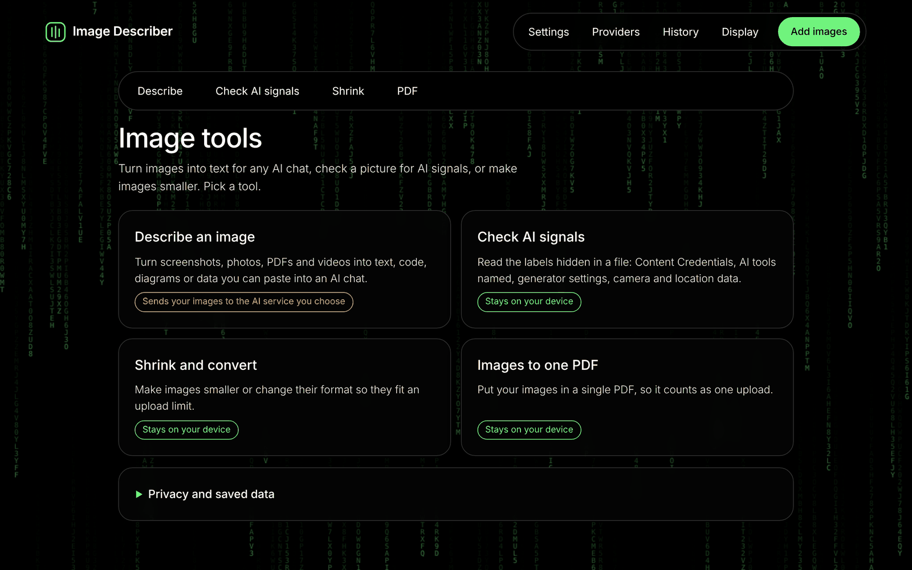
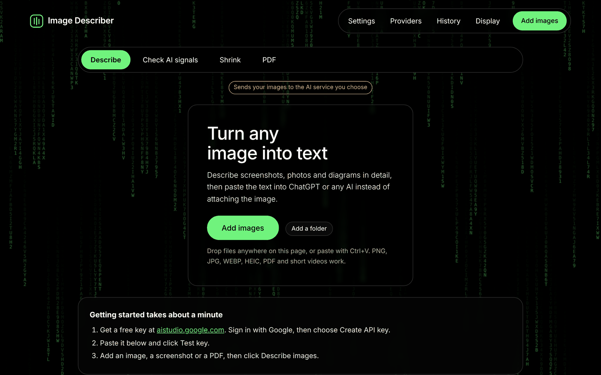

# Image Describer

Turn images, screenshots, PDFs and short videos into text that you can paste into any AI chat, so you don't have to attach the image. It runs entirely in the browser: no server, no build step, no accounts.

**Live demo:** https://22shaban.github.io/describer-site/ (also on Cloudflare: https://imagedescriber.shabanshaikhit.workers.dev)

## Why it exists

Free AI chat plans cap how many files you can attach each day, and text pastes don't count toward that cap. This tool uses a vision model to write a detailed, structured description of an image, then helps you check it, fix it and paste it.

## What it does

- **Five outputs:** a written description, HTML and CSS for a screenshot, a Mermaid diagram, CSV data from a chart or table, an alt text pair, or a prompt for an image generator.
- **Accuracy tools:** a self-check pass by a second model, a test that asks questions about the image and checks whether the text alone can answer them, optional 2x2 or 3x3 tiles for dense images, and a side-by-side view of what the self-check changed.
- **Inputs:** images, PDFs (page images plus the PDF's own text), short videos (evenly spaced frames), and whole folders.
- **Output tools:** copy with an intro line, split into parts for long text, export as .txt, .md, .json, a zip with the original images, or a single HTML report.
- **Reliability:** several models tried in order, optional backup services (Groq, OpenRouter), automatic waiting on per-minute rate limits, retry per image, history that reuses saved results without spending quota.
- **More tools (run locally):** check an image for AI signals and metadata (Content Credentials, the digital-source-type label, tools named in the file, image-generator settings, camera and GPS data), shrink and convert images to fit upload limits, and combine images into one PDF. The checker reads only what is written in the file. It cannot read invisible pixel watermarks such as SynthID, which only the watermark's owner can detect.
- **Layout:** a home screen with four tool cards and a tab bar (Describe, Check AI signals, Shrink, PDF), each tab with its own address, a badge saying whether it sends data to an AI service or stays on your device, and links between tools (for example, shrink then describe, or check an image from the describer list).
- **Interface:** Matrix-style dark theme with a light option, high-contrast switch, installable as an app, works offline once loaded (the AI itself needs the internet).

## How it works

Each visitor pastes their own free API key (Google Gemini; Groq and OpenRouter are optional). The page measures the image's real colors, sends the image and a task-specific prompt straight from the browser to the AI service, cleans the result, and keeps everything in the page. Local OCR (Tesseract.js) and PDF reading (pdf.js) run in the browser.

## Privacy

- The hosting only serves static files; it never receives images, text or keys.
- Images and requests go from the browser to the AI service you choose, and that service's terms apply. Free tiers may use inputs to improve their products, so don't send private images.
- Saved in the browser only: keys (only if you tick "Remember my keys", stored as plain text), history with tiny thumbnails, presets, settings and request counts. A button in the page deletes all of it.
- Loaded from other sites when needed: Google Fonts, and jsDelivr for Tesseract.js, pdf.js and the Mermaid preview.

## Limits

- Descriptions come from an AI, so they can contain mistakes. The accuracy test is graded by an AI too, so treat it as a guide.
- A description is a summary, not a pixel-exact copy of the image.
- Free API tiers have small per-minute and per-day limits, and model names change. Use "Find models" to refresh the list.

## Files

- `index.html`: the whole app
- `manifest.webmanifest`, `sw.js`, `icon.svg`, `icon-192.png`, `icon-512.png`: install and offline support

## Deploy

It is a folder of static files, so any static host works.

- **Cloudflare:** Workers & Pages, create a project, upload this folder, deploy. To update, make a new deployment with the new files.
- **GitHub Pages:** put the files in a repository, turn on Pages for that branch. Note that a project repo in the same account as a user site with a custom domain is served under that domain.
- **S3 + CloudFront:** upload the files and serve over HTTPS. Invalidate `/index.html` after each upload.

The service worker is network-first, so updates show on the next visit. If you change `sw.js`, raise the `CACHE` version inside it.

Never put an API key in these files.

## Built with

Plain HTML, CSS and JavaScript. Tesseract.js, pdf.js and Mermaid are loaded from jsDelivr only when used. Built with AI assistance.

## License

MIT. See [LICENSE](LICENSE).
